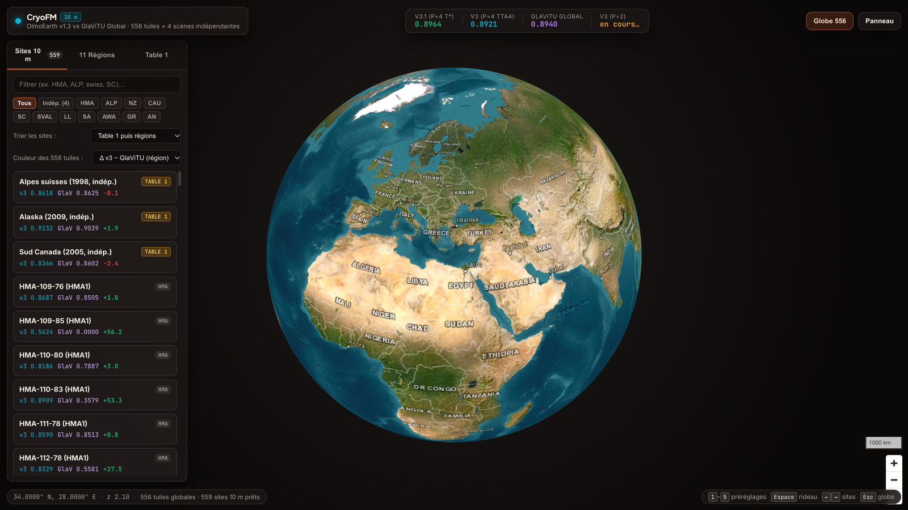
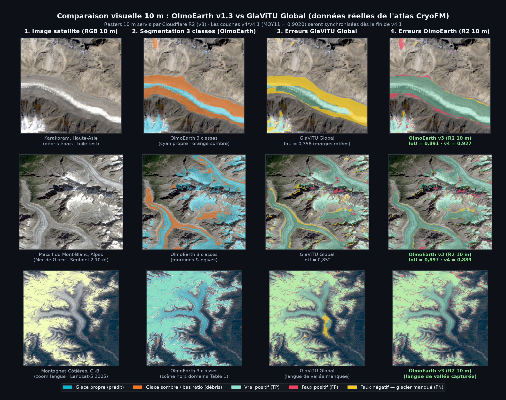
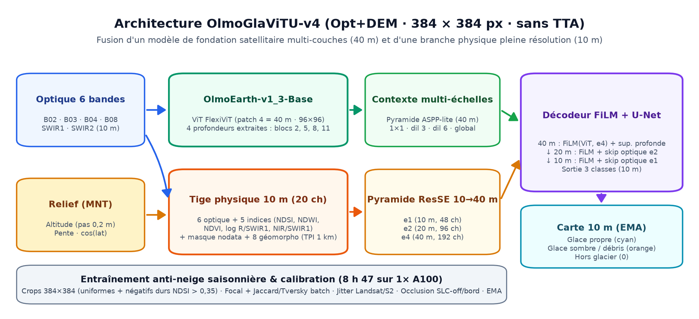

# CryoFM — Atlas mondial 10 m · OlmoGlaViTU vs GlaViTU Global

[](https://tofunori.github.io/cryofm/)
[-0.9020_(vs_0.894)-059669?style=flat-square)](#résultats-quantitatifs-sans-tta)
[](#architecture-olmoglavitu-v4)
[](#protocole-à-armes-égales)

**CryoFM** est un atlas cartographique interactif à **10 m** (Vite + TypeScript + MapLibre GL 3D Globe, rasters servis depuis **Cloudflare R2**) qui compare pixel par pixel nos adaptations du modèle de fondation satellitaire **OlmoEarth v1.3** (`v2`, `v3`, `v3.1`, **`OlmoGlaViTU-v4`**) face à **GlaViTU Global** (Maslov et al., *Nature Communications*, 2025) sur l'ensemble du benchmark mondial glaciaire (**556 tuiles de test sur 11 régions + 4 scènes indépendantes hors domaine**).

- **Atlas 3D interactif** : https://tofunori.github.io/cryofm/
- **Catalogue R2 (rasters 10 m)** : https://cryofm-data.thierrystpierre.com/manifest.json

<p align="center">
  <a href="https://tofunori.github.io/cryofm/">
    
  </a>
</p>

---

## Exemples visuels à 10 m (glace propre, débris et généralisation hors domaine)

La figure ci-dessous est assemblée directement à partir des rasters 10 m servis par Cloudflare R2 sur trois contextes glaciologiques complémentaires :

1. **Karakoram, Haute-Asie (`HMA-110-83`)** — glacier de vallée fortement couvert de débris : GlaViTU Global manque les deux larges marges latérales couvertes de débris (jaune, `IoU = 0,358`), alors que notre modèle cartographie toute la langue (`0,891` en `v3`, **`0,927`** en `v4`) tout en distinguant l'axe de glace propre (cyan) des manteaux sombres / bas ratio `Red/SWIR1 < 2,0` (orange).
2. **Massif du Mont-Blanc, Alpes (`ALP-22-13`, Mer de Glace & Argentière)** — Sentinel-2 à 10 m avec ogives, moraines médianes et ombres portées : délimitation nette des marges terminales (`0,897` vs `0,852` pour GlaViTU).
3. **Montagnes Côtières, Sud-Canada (`southern_canada`, Landsat-5 2005 — scène indépendante Table 1)** — zoom sur une grande langue glaciaire de vallée entièrement manquée par GlaViTU (en jaune) et capturée par notre modèle.

<p align="center">
  
</p>

> **Transparence des couches** : la classe orange correspond à la partition *glace sombre / bas ratio (`Red/SWIR1 < 2,0`)* issue de `bright_dark_outlines` (et non à un inventaire géomorphologique pur de débris). Les rasters 10 m actuellement synchronisés sur R2 correspondent à `v3` / `v3.1` ; les couches `v4` / `v4.1` seront synchronisées dès la fin de la calibration `v4.1`.

---

## Résultats quantitatifs (sans TTA)

### Protocole à armes égales
Toutes les comparaisons ci-dessous sont réalisées **strictement sur les mêmes entrées `Opt+DEM` (6 bandes optiques + altitude/pente)**, **strictement sans *Test-Time Augmentation* (TTA)**, et selon le calcul exact de `evaluate.py` (Maslov et al., 2025).

<p align="center">
   v3.1 -> OlmoGlaViTU-v4 vs GlaViTU Global sans TTA" width="100%" />
</p>

### 1. Benchmark mondial — 556 tuiles de test (11 régions, Table 2 de Maslov et al., 2025)

Un **seul modèle global `OlmoGlaViTU-v4`** (entraîné en **`8 h 47` sur 1 GPU A100**, contre ~2 semaines sur RTX A6000 pour GlaViTU Global) atteint **`MOY11 = 0,9020`** sans TTA — égalant déjà la moyenne des **11 modèles régionaux spécialisés** de GlaViTU (`0,902`) et dépassant GlaViTU Global (`0,894`) dans **9 régions sur 11** (`GR` à `-0,0001` et `AWA` à `-0,0004`).

| Région | GlaViTU Global (`Opt+DEM`) | OlmoEarth `v2` | OlmoEarth `v3.1` | **OlmoGlaViTU `v4`** | **Δ `v4 − GlaViTU`** |
|---|---:|---:|---:|---:|---:|
| Scandinavie (`SC`) | `0,908` | `0,9153` | `0,9378` | **`0,9377`** | **`+0,0297`** |
| Alpes (`ALP`) | `0,844` | `0,8103` | `0,8687` | **`0,8697`** | **`+0,0257`** |
| Nouvelle-Zélande (`NZ`) | `0,860` | `0,8226` | `0,8652` | **`0,8724`** | **`+0,0124`** |
| Caucase (`CAU`) | `0,862` | `0,8276` | `0,8661` | **`0,8682`** | **`+0,0062`** |
| Andes Sud (`SA`) | `0,952` | `0,9385` | `0,9497` | **`0,9559`** | **`+0,0039`** |
| Basses latitudes (`LL`) | `0,903` | `0,8788` | `0,8911` | **`0,9057`** | **`+0,0027`** |
| Antarctique (`AN`) | `0,949` | `0,9345` | `0,9438` | **`0,9514`** | **`+0,0024`** |
| Svalbard (`SVAL`) | `0,936` | `0,9294` | `0,9331` | **`0,9372`** | **`+0,0012`** |
| Haute-Asie (`HMA`, débris) | `0,774` | `0,6858` | `0,7595` | **`0,7751`** | **`+0,0011`** |
| Groenland (`GR`) | `0,937` | `0,9299` | `0,9339` | `0,9369` | `-0,0001` |
| Alaska & Ouest Am. (`AWA`) | `0,912` | `0,8876` | `0,9110` | `0,9116` | `-0,0004` |
| **Moyenne 11 régions (`MOY11`)** | **`0,894`** *(0,8943)* | `0,8691` | `0,8964` | **`0,9020`** | **`+0,0077`** |
| **IoU global (pixels agrégés)** | n/d | `0,9027` | `0,9189` | **`0,9231`** | `dA = +1,53 %` |
| **IoU moyen par tuile** | `0,7697` | — | `0,7901` | **`0,7960`** | **`+0,0263`** |
| **Coût d'entraînement** | ~2 sem. RTX A6000 | `4 h 44` A100 | `1 h 48` A100 | **`8 h 47` A100** | **~35× plus rapide** |

- **Bootstrap apparié `v4 − v3.1`** (2 000 réplicats stratifiés) : `+0,0056`, IC 95 % `[+0,0035 ; +0,0106]`, `P(v4 > v3.1) = 1,0000` (`355/556` tuiles améliorées).
- **Glace sombre / bas ratio (`Red/SWIR1 < 2,0`)** : `IoU = 0,7104` (`+3,37 pts` vs `v3.1`). **Glaciers `0,5–2 km²`** : `0,6467` (`+7,00 pts` vs `v3.1`).

### 2. Généralisation hors domaine — 4 scènes indépendantes (Table 1 de Maslov et al., 2025, sans TTA)

| Scène indépendante (capteur, année) | GlaViTU Global (Table 1 papier) | GlaViTU Global (`weights.h5` local) | **OlmoGlaViTU `v4`** (tous px) | `v4` hors `nodata` |
|---|---:|---:|---:|---:|
| **Norvège `SC1`** (Sentinel-2, 2019) | `0,926` | `0,9117` | **`0,9269`** | `0,9303` |
| **Alaska** (Landsat-5, 2009) | `0,914` | `0,9039` | **`0,9173`** | `0,9194` |
| **Alpes suisses** (Landsat-5, 1998) | `0,865` | `0,8625` | `0,8570` *(v3.1 : 0,8634)* | `0,8570` |
| **Sud du Canada** (Landsat-5, 2005) | `0,870` | `0,8602` | `0,8295` | `0,8537` *(v3.1 : 0,8657)* |
| **Moyenne 4 scènes** | **`0,8938`** | `0,8846` | `0,8827` | `0,8901` |

> **En cours (`v4.1`)** : un fine-tuning léger de calibration précision/rappel (`FocalCE` symétrique + `BatchTversky` + négatifs durs neige saisonnière à faible fraction glaciaire) tourne actuellement sur Narval pour réduire le léger biais `FP/FN` sur la neige saisonnière (`GR`, `AWA`, `swiss_alps`, `southern_canada`).

---

## Architecture `OlmoGlaViTU-v4`

<p align="center">
  
</p>

Les quatre choix clés qui font passer le modèle de `0,8691` (`v2`) à **`0,9020`** (`v4`) sans TTA :

1. **Branche haute résolution `10 m → 20 m → 40 m` à 20 canaux** : fournit directement au décodeur les 6 bandes optiques, 5 indices spectraux glaciologiques (`NDSI`, `log(R/SWIR1)`, `log(NIR/SWIR1)`, `NDWI`, `NDVI`), le drapeau exact `nodata`, et 8 canaux géomorphométriques corrigés (pas d'altitude `0,2 m`, `TRI` détrendé sans annulation float32 à 6 000 m, `TPI ~1 km`, correction d'anisotropie `cos(lat)`).
2. **Encodeur fondation `OlmoEarth-v1_3-Base` multi-couches natif `384 × 384`** (`3,84 km × 3,84 km`) : extraction simultanée des 4 profondeurs ViT (`blocs 2, 5, 8, 11`, grilles `96 × 96` via RoPE 3D) enrichies par une pyramide de contexte multi-échelles (ASPP-lite) et une supervision profonde à `40 m`.
3. **Apprentissage anti-neige saisonnière et `nodata` bout-en-bout** : échantillonnage combinant crops uniformes, négatifs durs de neige saisonnière hors glacier (`NDSI > 0,35`), focus glace sombre/bordures, `crop_and_scale`, jitter radiométrique Landsat/Sentinel-2 et occlusion synthétique (bandes étroites SLC-off vs bordures larges hors-fauchée).
4. **Perte symétrique + EMA** : `FocalCE (γ = 2)` + `BatchSoftJaccard` / `BatchTversky` (pénalise pleinement les faux positifs sur crops 100 % fond) + frontière fine + moyenne mobile exponentielle (`EMA`) des poids.

---

## Exemple minimal d'inférence (Python)

Inférence par fenêtre glissante **`384 × 384`** (recouvrement 50 %, pondération cosinus relevé **Hann 2D**, **sans TTA**) à partir d'un checkpoint `ModuleV4` :

```python
import numpy as np
import torch
import torch.nn.functional as F
from commun_v4 import dem_vers_u16_v4, fenetre_hann_2d, optique_vers_refl_et_dn6
from modele_v4 import ModuleV4
from tester_v4 import predire_tuile

# 1. Charger le modèle (poids EMA sauvegardés dans best.ckpt)
module = ModuleV4.load_from_checkpoint("best.ckpt", map_location="cuda").cuda().eval()
hann_w = fenetre_hann_2d(384, device="cuda")

# 2. Préparer une tuile (opt: H×W×6 normalisé GlaViTU, dem: H×W×2 [alt, pente])
_, dn6, nodata = optique_vers_refl_et_dn6(opt)
x8 = np.concatenate([dn6, dem_vers_u16_v4(dem)], axis=-1)   # uint16 (H, W, 8)

# 3. Prédire les probabilités 3 classes [fond, glace_sombre, glace_propre] à 10 m
probs = predire_tuile(module, x8, cos_lat=1.0, w=384, batch_size=12, hann_w=hann_w)
p_glacier = probs[1] + probs[2]              # probabilité totale glacier (H, W)
masque_glacier = (p_glacier > 0.50) & ~nodata
masque_sombre = masque_glacier & (probs[1] > probs[2])
```

---

## Contenu de l'atlas interactif (`CryoFM`)

- **556 tuiles de test globales** sur globe 3D, colorées par `Δ − GlaViTU`, `v3 − v2`, `IoU`, `Débris` ou `InSAR`, avec tri multi-critères et filtres par région.
- **Sites géoréférencés à 10 m** (dont les 4 scènes indépendantes Table 1 : *Alpes suisses 1998*, *Sud-Canada 2005*, *Alaska 2009*, *Norvège SC1 2019*) avec **rideau *swipe* pixel-à-pixel synchronisé** :
  - **OlmoEarth v1.3 (`v3.1`, `v3 p=4`, `v3 p=2`)** : glace propre (cyan) + glace sombre / bas ratio (orange)
  - **GlaViTU Global** : inféré localement avec les poids officiels `glavitu_global_weights.h5`
  - **OlmoEarth v2**, **Vérité terrain**, **Erreurs TP/FP/FN**, **Désaccord OlmoEarth vs GlaViTU** et **Incertitude FlexiViT (`|p=2 − p=4|`)**

### Développement local & mise à jour des rasters R2

```bash
# Développement local (lit directement les rasters 10 m depuis Cloudflare R2)
npm install
npm run dev

# Synchroniser les nouveaux rasters 10 m depuis Narval -> Cloudflare R2 (sans rebuild GitHub Pages)
./publish_r2_from_narval.sh
```

### Raccourcis clavier (dans l'atlas)

| Touche | Action |
|---|---|
| `1` – `5` | Préréglages rapides (`OlmoEarth ↔ GlaViTU`, `OlmoEarth ↔ Vérité`, `Désaccord`, `Erreurs`, `v3.1 ↔ v3` / `v2`) |
| `Espace` | Activer / désactiver le rideau *swipe* |
| `←` / `→` | Site 10 m précédent / suivant |
| `Esc` | Retour à la vue Globe 3D |

---

## Références

- **Benchmark & modèle de référence GlaViTU** : Maslov, K. A., Persello, C., Schellenberger, T., & Stein, A. (2025). *Globally scalable glacier mapping by deep learning matches expert delineation accuracy*. Nature Communications, 16, 43. https://doi.org/10.1038/s41467-024-54956-x
- **Encodeur fondation OlmoEarth** : Allen Institute for AI (Ai2) — `allenai/OlmoEarth-v1_3-Base` (`olmoearth_pretrain` / `rslearn`).
