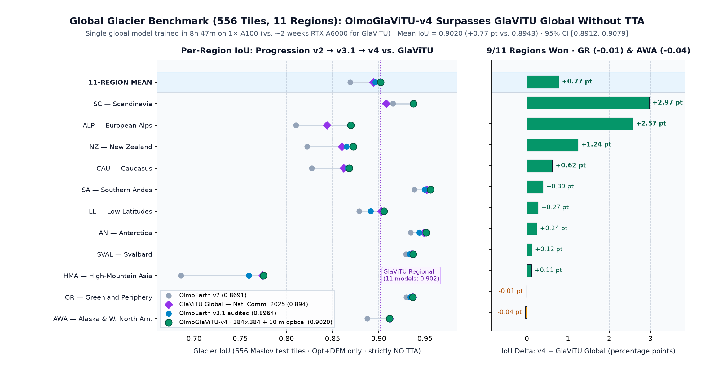

# CryoFM — Interactive 10 m Global Glacier Atlas · OlmoGlaViTU vs. GlaViTU Global

[](https://tofunori.github.io/cryofm/)
[-0.9020_(vs._0.894)-059669?style=flat-square)](#quantitative-results-no-tta)
[](#olmoglavitu-v4-architecture)
[](#apples-to-apples-protocol)

**CryoFM** is an interactive **10 m** global glacier mapping atlas (Vite + TypeScript + MapLibre GL 3D Globe, with 10 m rasters streamed from **Cloudflare R2**) comparing our adaptations of the **OlmoEarth v1.3** geospatial foundation model (`v2`, `v3`, `v3.1`, **`OlmoGlaViTU-v4`**) pixel-for-pixel against **GlaViTU Global** (Maslov et al., *Nature Communications*, 2025) across the entire global benchmark (**556 test tiles spanning 11 glacierized regions + 4 independent out-of-domain acquisitions**).

- **Interactive 3D Atlas**: https://tofunori.github.io/cryofm/
- **10 m Raster Manifest (R2 CDN)**: https://cryofm-data.thierrystpierre.com/manifest.json

<p align="center">
  <a href="https://tofunori.github.io/cryofm/">
    
  </a>
</p>

---

## 10 m Visual Examples (Clean Ice, Debris Cover & Out-of-Domain Generalization)

The plate below is assembled directly from the 10 m rasters served by Cloudflare R2 across three complementary glaciological settings:

1. **Karakoram, High-Mountain Asia (`HMA-110-83`)** — heavily debris-covered valley glacier: GlaViTU Global misses both wide lateral debris-covered flanks (yellow FN, `IoU = 0.358`), whereas our model maps the entire tongue (`0.891` in `v3`, **`0.927`** in `v4`) while separating clean ice along the central spine (cyan) from dark / low-ratio ice (`Red/SWIR1 < 2.0`, orange).
2. **Mont-Blanc Massif, European Alps (`ALP-22-13`, Mer de Glace & Argentière)** — 10 m Sentinel-2 imagery with ogives, medial moraines, and cast shadows: sharper terminal and lateral margins (`0.897` vs. `0.852` for GlaViTU).
3. **Coast Mountains, Southern Canada (`southern_canada`, Landsat-5 2005 — Table 1 independent OOD scene)** — zoomed view of a major valley glacier terminus completely missed by GlaViTU (yellow) and cleanly captured by our model.

<p align="center">
  
</p>

> **Layer transparency note**: the orange class reflects the *dark / low-ratio ice (`Red/SWIR1 < 2.0`)* partition from `bright_dark_outlines` rather than a pure geomorphological supraglacial debris inventory. The live R2 10 m rasters currently display `v3` / `v3.1`; `v4` / `v4.1` overlays will be synced upon completion of `v4.1`.

---

## Quantitative Results (No TTA)

### Apples-to-Apples Protocol
All comparisons use **strictly identical `Optical+DEM` inputs (6 optical bands + elevation/slope)**, **strictly no Test-Time Augmentation (TTA)**, and exact parity with GlaViTU's official `evaluate.py` (Maslov et al., 2025).

<p align="center">
   v3.1 -> OlmoGlaViTU-v4 vs. GlaViTU Global without TTA" width="100%" />
</p>

### 1. Global Benchmark — 556 Test Tiles (11 Regions, Maslov et al. 2025, Table 2)

A **single global `OlmoGlaViTU-v4` model** (trained in **`8h 47m` on 1× A100**, vs. ~2 weeks on an RTX A6000 for GlaViTU Global) reaches **`0.9020` 11-region mean IoU** without TTA — already matching the average of GlaViTU's **11 separate regional specialist models (`0.902`)** and outperforming GlaViTU Global (`0.894`) in **9 of 11 regions** (with `GR` at `-0.0001` and `AWA` at `-0.0004`).

| Region | GlaViTU Global (`Opt+DEM`) | OlmoEarth `v2` | OlmoEarth `v3.1` | **OlmoGlaViTU `v4`** | **Δ `v4 − GlaViTU`** |
|---|---:|---:|---:|---:|---:|
| Scandinavia (`SC`) | `0.908` | `0.9153` | `0.9378` | **`0.9377`** | **`+0.0297`** |
| European Alps (`ALP`) | `0.844` | `0.8103` | `0.8687` | **`0.8697`** | **`+0.0257`** |
| New Zealand (`NZ`) | `0.860` | `0.8226` | `0.8652` | **`0.8724`** | **`+0.0124`** |
| Caucasus (`CAU`) | `0.862` | `0.8276` | `0.8661` | **`0.8682`** | **`+0.0062`** |
| Southern Andes (`SA`) | `0.952` | `0.9385` | `0.9497` | **`0.9559`** | **`+0.0039`** |
| Low Latitudes (`LL`) | `0.903` | `0.8788` | `0.8911` | **`0.9057`** | **`+0.0027`** |
| Antarctica (`AN`) | `0.949` | `0.9345` | `0.9438` | **`0.9514`** | **`+0.0024`** |
| Svalbard (`SVAL`) | `0.936` | `0.9294` | `0.9331` | **`0.9372`** | **`+0.0012`** |
| High-Mountain Asia (`HMA`, debris) | `0.774` | `0.6858` | `0.7595` | **`0.7751`** | **`+0.0011`** |
| Greenland Periphery (`GR`) | `0.937` | `0.9299` | `0.9339` | `0.9369` | `-0.0001` |
| Alaska & W. North America (`AWA`) | `0.912` | `0.8876` | `0.9110` | `0.9116` | `-0.0004` |
| **11-Region Mean** | **`0.894`** *(0.8943)* | `0.8691` | `0.8964` | **`0.9020`** | **`+0.0077`** |
| **Global Pixel IoU** | n/a | `0.9027` | `0.9189` | **`0.9231`** | `dA = +1.53%` |
| **Mean Per-Tile IoU** | `0.7697` | — | `0.7901` | **`0.7960`** | **`+0.0263`** |
| **Training Compute** | ~2 wks RTX A6000 | `4h 44m` A100 | `1h 48m` A100 | **`8h 47m` A100** | **~35× faster** |

- **Paired bootstrap `v4 − v3.1`** (2,000 region-stratified replicates): `+0.0056`, 95% CI `[+0.0035, +0.0106]`, `P(v4 > v3.1) = 1.0000` (`355/556` tiles improved).
- **Dark / low-ratio ice (`Red/SWIR1 < 2.0`)**: `IoU = 0.7104` (`+3.37 pts` over `v3.1`). **Small glaciers (`0.5–2 km²`)**: `0.6467` (`+7.00 pts` over `v3.1`).

### 2. Out-of-Domain Generalization — 4 Independent Acquisitions (Maslov et al. 2025, Table 1, No TTA)

| Independent Scene (Sensor, Year) | GlaViTU Global (Table 1 paper) | GlaViTU Global (local `weights.h5`) | **OlmoGlaViTU `v4`** (all px) | `v4` excl. `nodata` |
|---|---:|---:|---:|---:|
| **Southern Norway `SC1`** (Sentinel-2, 2019) | `0.926` | `0.9117` | **`0.9269`** | `0.9303` |
| **Alaska** (Landsat-5, 2009) | `0.914` | `0.9039` | **`0.9173`** | `0.9194` |
| **Swiss Alps** (Landsat-5, 1998) | `0.865` | `0.8625` | `0.8570` *(v3.1: 0.8634)* | `0.8570` |
| **Southern Canada** (Landsat-5, 2005) | `0.870` | `0.8602` | `0.8295` | `0.8537` *(v3.1: 0.8657)* |
| **4-Scene Mean** | **`0.8938`** | `0.8846` | `0.8827` | `0.8901` |

> **In progress (`v4.1`)**: a targeted precision/recall calibration fine-tuning pass (symmetric `FocalCE` + `BatchTversky` + low-glacier-fraction seasonal snow hard negatives) is currently running on Narval to eliminate the residual seasonal-snow over-prediction on `GR`, `AWA`, `swiss_alps`, and `southern_canada`.

---

## `OlmoGlaViTU-v4` Architecture

<p align="center">
  
</p>

Four design choices drive the jump from `0.8691` (`v2`) to **`0.9020`** (`v4`) without TTA:

1. **Full-resolution `10 m → 20 m → 40 m` 20-channel physics stem**: feeds the decoder directly with the 6 optical bands, 5 glaciological spectral indices (`NDSI`, `log(R/SWIR1)`, `log(NIR/SWIR1)`, `NDWI`, `NDVI`), an exact `nodata` flag, and 8 corrected geomorphometry channels (`0.2 m` elevation quantization, detrended `TRI` without float32 cancellation at 6,000 m, `~1 km` macro-`TPI`, and `cos(lat)` anisotropy correction).
2. **Native `384 × 384` (`3.84 km`) multi-depth `OlmoEarth-v1_3-Base` backbone**: extracts 4 transformer depths (`blocks 2, 5, 8, 11`, `96 × 96` token grids via 3D RoPE) enriched by an ASPP-lite multi-scale context pyramid and `40 m` deep supervision.
3. **Anti-seasonal-snow & end-to-end `nodata` training**: mixes uniform crops, `NDSI > 0.35` seasonal-snow hard negatives, dark-ice/boundary crops, `crop_and_scale`, cross-sensor Landsat/Sentinel-2 radiometric jitter, and synthetic optical occlusion (narrow SLC-off stripes vs. wide exterior swath borders).
4. **Symmetric loss + EMA**: `FocalCE (γ = 2)` + batch-level `SoftJaccard` / `SoftTversky` (fully penalizing false positives on empty-glacier snow crops) + boundary refinement + Exponential Moving Average (`EMA`) weights.

---

## Minimal Inference Example (Python)

Sliding-window **`384 × 384`** inference (50% overlap, 2D raised-cosine **Hann** blending, **no TTA**) from a `ModuleV4` checkpoint:

```python
import numpy as np
import torch
from commun_v4 import dem_vers_u16_v4, fenetre_hann_2d, optique_vers_refl_et_dn6
from modele_v4 import ModuleV4
from tester_v4 import predire_tuile

# 1. Load model (EMA weights stored in best.ckpt)
module = ModuleV4.load_from_checkpoint("best.ckpt", map_location="cuda").cuda().eval()
hann_w = fenetre_hann_2d(384, device="cuda")

# 2. Prepare a tile (opt: HxWx6 GlaViTU-normalized optical, dem: HxWx2 [elev, slope])
_, dn6, nodata = optique_vers_refl_et_dn6(opt)
x8 = np.concatenate([dn6, dem_vers_u16_v4(dem)], axis=-1)   # uint16 (H, W, 8)

# 3. Predict 3-class probabilities [background, dark_ice, clean_ice] at 10 m
probs = predire_tuile(module, x8, cos_lat=1.0, w=384, batch_size=12, hann_w=hann_w)
p_glacier = probs[1] + probs[2]              # total glacier probability (H, W)
glacier_mask = (p_glacier > 0.50) & ~nodata
dark_ice_mask = glacier_mask & (probs[1] > probs[2])
```

---

## Interactive Atlas Features (`CryoFM`)

- **556 global test tiles** on an interactive 3D globe, color-coded by `Δ − GlaViTU`, `v3 − v2`, `IoU`, `Debris`, or `InSAR`, with multi-criteria sorting and regional filtering.
- **Georeferenced 10 m sites** (including the 4 Table 1 independent scenes: *Swiss Alps 1998*, *Southern Canada 2005*, *Alaska 2009*, *Norway SC1 2019*) with a **synchronized pixel-for-pixel swipe curtain**:
  - **OlmoEarth v1.3 (`v3.1`, `v3 p=4`, `v3 p=2`)**: clean ice (cyan) + dark / low-ratio ice (orange)
  - **GlaViTU Global**: inferred locally using the official `glavitu_global_weights.h5` weights
  - **OlmoEarth v2**, **Reference Ground Truth**, **TP/FP/FN Error Maps**, **Model Disagreement**, and **FlexiViT Uncertainty (`|p=2 − p=4|`)**

### Local Development & R2 Raster Sync

```bash
# Local dev server (streams 10 m rasters directly from Cloudflare R2)
npm install
npm run dev

# Sync updated 10 m rasters from Narval -> Cloudflare R2 (no GitHub Pages rebuild needed)
./publish_r2_from_narval.sh
```

### Keyboard Shortcuts (Inside the Atlas)

| Key | Action |
|---|---|
| `1` – `5` | Quick layer presets (`OlmoEarth ↔ GlaViTU`, `OlmoEarth ↔ Ground Truth`, `Disagreement`, `Errors`, `v3.1 ↔ v3` / `v2`) |
| `Space` | Toggle swipe curtain |
| `←` / `→` | Previous / next 10 m site |
| `Esc` | Return to 3D Globe view |

---

## References

- **Benchmark & GlaViTU Baseline**: Maslov, K. A., Persello, C., Schellenberger, T., & Stein, A. (2025). *Globally scalable glacier mapping by deep learning matches expert delineation accuracy*. Nature Communications, 16, 43. https://doi.org/10.1038/s41467-024-54956-x
- **OlmoEarth Foundation Backbone**: Allen Institute for AI (Ai2) — `allenai/OlmoEarth-v1_3-Base` (`olmoearth_pretrain` / `rslearn`).
